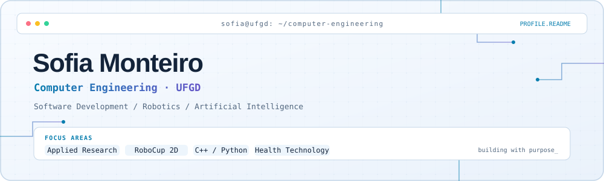

  <picture>
    <source media="(prefers-color-scheme: dark)" srcset="assets/banner-dark.svg">
    <source media="(prefers-color-scheme: light)" srcset="assets/banner-light.svg">
    
  </picture>

<h2 align="center">Hi, I'm Sofia! 👋</h2>

  Computer Engineering undergraduate at <strong>Universidade Federal da Grande Dourados (UFGD)</strong>. 
  Interested in <strong>software development, artificial intelligence, robotics and applied research</strong>.

---

### About me

I'm a Computer Engineering student who enjoys turning academic knowledge into practical solutions. Throughout my degree, I've been involved in projects that connect technology with real-world challenges, especially in robotics, healthcare and research.

- 🔬 **Applied research:** I participate in the technological initiation project behind *Mãe Informa*, an app focused on self-care in the context of gestational diabetes, developed in partnership with the UFGD University Hospital. The work was presented at VIII COENPE and received an Honorable Mention for Best Work in Technology, Innovation and Health Care.
- 🤖 **Robotics:** I'm part of the UFGD Robotics Group, where I serve as secretary and contribute to the software development of **RoboCup Soccer Simulation 2D**, using C++ and the HELIOS base.
- 👩‍💻 **Community:** I helped found a study group for women in Computing, encouraging collaborative learning and greater participation in technology.
- 📚 **Academic life:** I also take part in scientific events, university outreach and student representation.

### Technologies & tools

  
  
  
  
  
  
  

### Featured projects

| Project | About |
|---|---|
| **RoboCup Soccer Simulation 2D** | Software development for a 2D robotic soccer simulation team, using C++ and the HELIOS base. |
| **Mãe Informa** | Health technology project focused on supporting self-care in gestational diabetes, in partnership with the UFGD University Hospital. |
| **Marciano vs. Caçador** | Adventure and investigation game inspired by Brazilian folklore, developed with Python and Pygame. |

### Beyond the code

I believe technology becomes more meaningful when it creates opportunities, supports people and encourages collaboration. That's why I value research, knowledge sharing and initiatives that make Computing more welcoming and inclusive.

### Contact

  
  

---

<i>Always learning, building and exploring new possibilities.</i>

